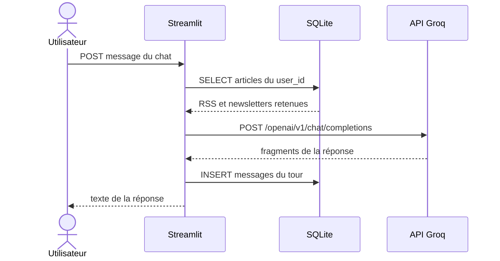
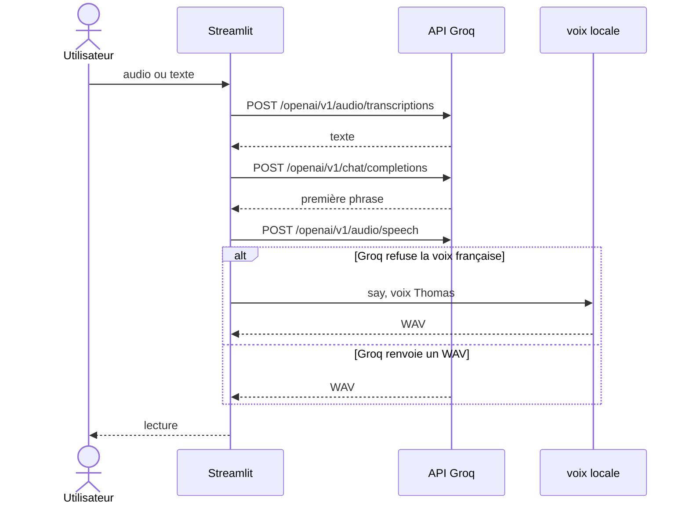
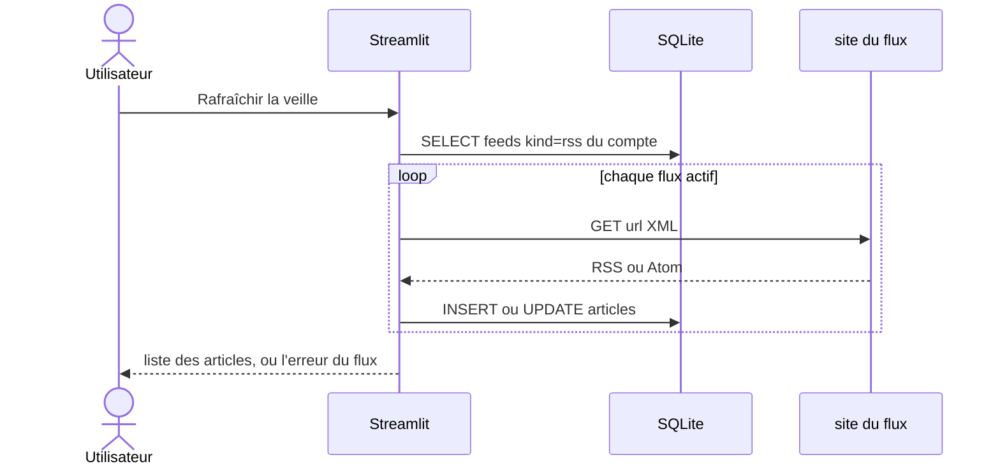
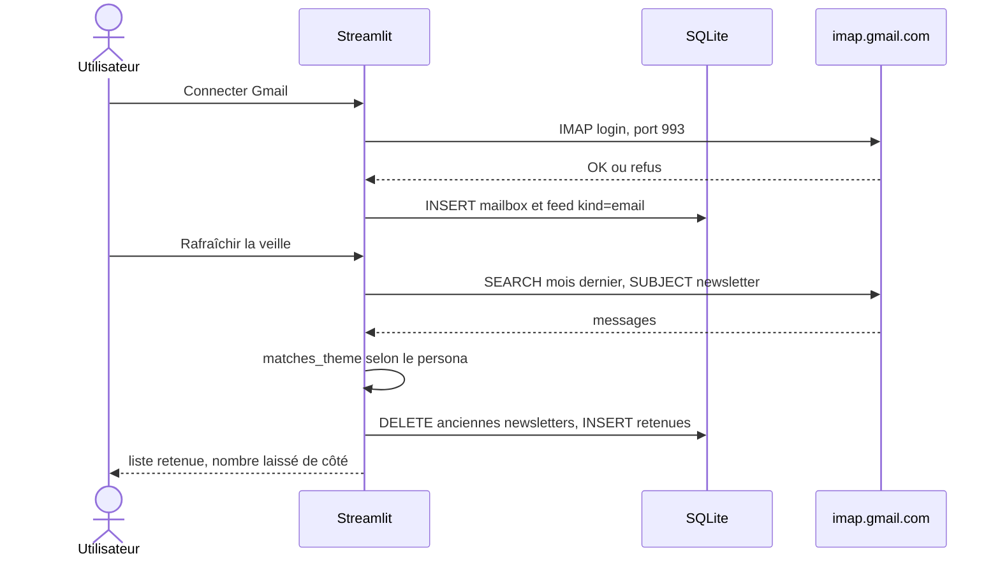
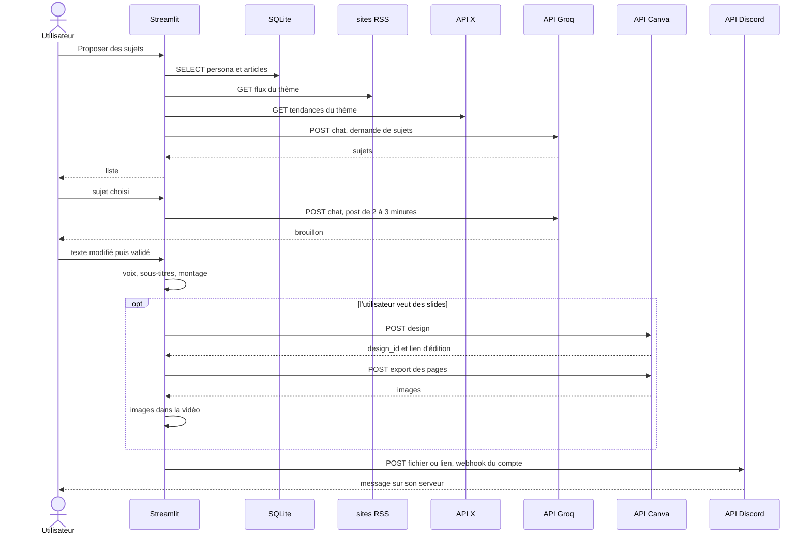
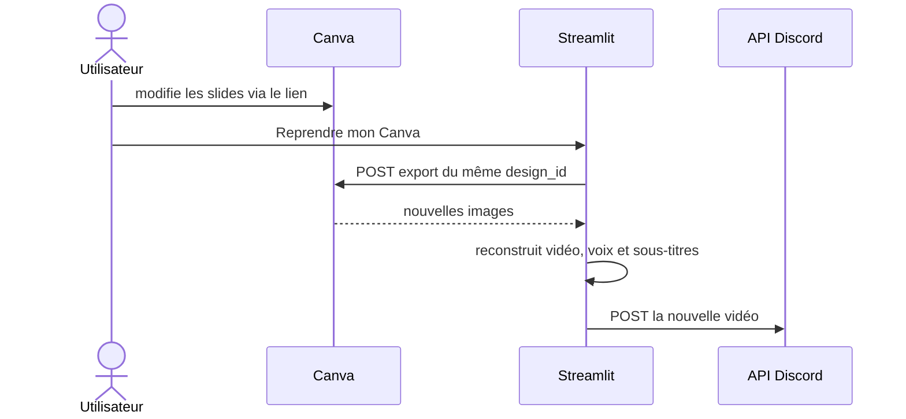

# Diagramme de séquences — requêtes HTTP

IMAP vers Gmail n'est pas une requête HTTP. Il est dessiné à part, parce que la veille e-mail passe par lui.

Les séquences marquées **prévu** décrivent la cible. Le code ne les fait pas.

## Déjà en place

### Question, avec la veille déjà en base

L'appel Groq part de `ask_llm`. Le corps contient `context.txt`, l'extrait de `digest_for`, l'historique de ce compte, puis la question. L'extrait n'est pas réenregistré dans l'historique.

### Réponse vocale

### Rafraîchir les flux RSS

Huit GET partent en parallèle, quatre à la fois. Une adresse en échec ne coupe pas les autres.

### Lire les newsletters

Le mot de passe d'application ne sort pas de SQLite. Il n'est pas dans une requête HTTP.

## Cible

### Proposer des sujets, écrire le post, monter la vidéo

### Reprendre le Canva modifié

Canva n'envoie pas d'appel à l'application quand l'utilisateur enregistre. L'export part au moment où l'utilisateur demande de reprendre les slides.

## Limites des requêtes prévues

| Service | Requête | Contrainte |
| --- | --- | --- |
| X | tendances | accès API payant, pas un simple GET public |
| Canva | créer, exporter | OAuth du compte Canva et identifiant du design |
| Discord | envoyer la vidéo | un webhook par compte ; un fichier trop lourd passe par un lien, pas par une pièce jointe |
| Groq | post de 2 à 3 minutes | appel déjà utilisé pour le chat, avec une consigne de durée différente de la réponse vocale courte |
