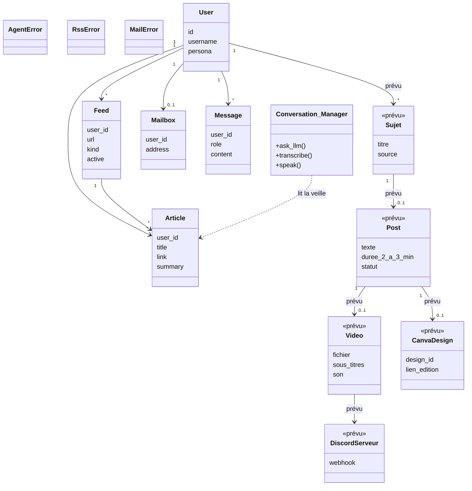
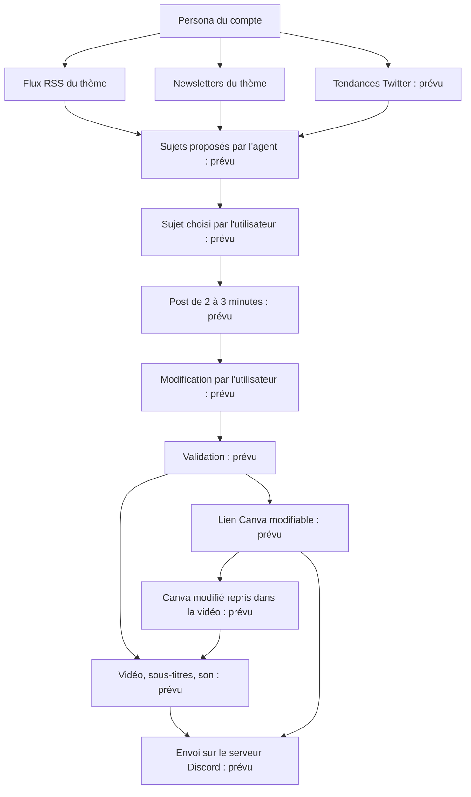

# Diagramme UML

Le fichier décrit le projet tel qu'il est, puis la cible. Une classe ou une fonction marquée **prévu** n'est pas dans le code.

Aujourd'hui, une seule classe porte le dialogue : `Conversation_Manager`. Le reste est des fonctions, regroupées par fichier. Les tables SQLite sont dessinées comme des classes de données.

## Classes et données

`veille_tech` et `veille_finance` sont les deux valeurs de `User.persona`.

## Fonctions en place

### Dialogue — `llm_agent.py`

| Fonction | Rôle |
| --- | --- |
| `Conversation_Manager.ask_llm` | Réponse Groq, avec historique, images, veille et persona |
| `Conversation_Manager.transcribe` | Audio vers texte |
| `Conversation_Manager.speak` | Texte vers audio |
| `prepare_image` | Réduit la photo avant l'envoi |
| `text_for_speech`, `first_spoken_sentence`, `split_for_speech` | Découpe la réponse pour la voix |

### Comptes et base — `db.py`

| Fonction | Rôle |
| --- | --- |
| `create_user`, `authenticate` | Compte et persona |
| `load_messages`, `add_message` | Historique du compte |
| `list_feeds`, `set_feed_active`, `recent_articles` | Flux et articles de ce compte |
| `save_mailbox`, `disconnect_mailbox`, `get_mailbox_credentials` | Boîte Gmail de ce compte |
| `get_user_persona`, `delete_mail_articles` | Thème du compte, nettoyage des newsletters |

### Veille RSS — `rss_watcher.py`

| Fonction | Rôle |
| --- | --- |
| `fetch_entries` | Télécharge un flux XML |
| `refresh_user` | Met à jour les flux du compte, puis les newsletters |
| `digest_for` | Extrait envoyé à l'agent : RSS du thème, newsletters retenues |

### Newsletters — `mail_watcher.py`

| Fonction | Rôle |
| --- | --- |
| `connect_mailbox` | Teste Gmail, puis enregistre le mot de passe d'application |
| `fetch_newsletters` | E-mails du mois précédent dont l'objet contient `newsletter` |
| `matches_theme` | Garde celles qui parlent de techno ou d'économie, selon le persona |
| `refresh_mailbox` | Remplace les newsletters du compte par les retenues |

### Page — `app.py`

| Fonction | Rôle |
| --- | --- |
| `require_user` | Connexion, création de compte, choix du persona |
| `show_veille` | Rafraîchir, flux, articles |
| `_show_gmail` | Connexion Gmail et newsletters retenues |
| `_handle_turn` | Question, réponse, enregistrement du tour |
| `stream_voice_answer` | Réponse lue à voix haute |

## Parcours cible

Ce parcours n'est pas codé. Il s'appuie sur la veille déjà en place.

Fonctions prévues, aucune n'existe encore :

| Fonction | Rôle |
| --- | --- |
| `propose_topics` | Trois à cinq sujets à partir du RSS, des newsletters retenues et des tendances |
| `fetch_trends` | Tendances Twitter du thème |
| `draft_post` | Texte parlable de 2 à 3 minutes sur le sujet choisi |
| `save_post_edit` | Garde la version modifiée par l'utilisateur |
| `build_video` | Monte images, voix et sous-titres |
| `send_discord` | Envoie la vidéo sur le serveur du compte |
| `create_canva` | Crée les slides et renvoie le lien d'édition |
| `refresh_canva` | Reprend le Canva modifié et reconstruit la vidéo |

Twitter n'a pas de flux RSS officiel utilisable comme les sites déjà branchés. Il faut l'API X, avec un accès qui se paie et se limite. Ce n'est pas le même branchement qu'un flux RSS.

## Reprendre un Canva modifié dans la vidéo

C'est possible, à trois conditions.

Le lien d'édition ne suffit pas. L'agent doit créer le design avec l'API Canva Connect, garder l'identifiant du design, et l'utilisateur doit autoriser l'application sur son compte Canva. Ensuite l'agent exporte les pages en images. La voix vient de la synthèse déjà en place, les sous-titres sont posés sur la vidéo au montage. Ce n'est pas l'export vidéo de Canva : celui-là n'a ni la voix de l'agent ni les sous-titres du script.

Si l'utilisateur modifie les slides, l'agent relance l'export du même design et refait le montage. Canva ne prévient pas tout seul : il faut un bouton du type « reprendre mon Canva », ou une vérification au moment de valider.

Sans API, sans identifiant de design, ou si l'utilisateur colle seulement une URL publique, l'agent ne peut pas lire le fichier modifié.
